<div align="center">

# 基于 YOLO11 的工业钢材表面缺陷检测

**面向 NEU-DET 的可复现目标检测工程：从 Baseline 到增强消融、多种子验证与 ONNX 部署一致性校验**

[](https://www.python.org/)
[](https://pytorch.org/)
[](https://github.com/ultralytics/ultralytics)
[](https://github.com/ultralytics/ultralytics)
[](#最终测试集结果)
[](LICENSE)

</div>

---

## 项目定位

本项目是**基于 [Ultralytics YOLO11](https://github.com/ultralytics/ultralytics) 官方实现的应用与工程优化项目**，不是原创检测算法，也不是任何论文的严格复现。核心工作在于：在固定数据划分与固定训练协议下，以**错误分析驱动**的方式研究输入分辨率、面向灰度纹理的数据增强策略对检测精度的影响，用多种子重复实验与独立测试集检验结论是否稳定，最后完成 ONNX 导出与推理一致性、延迟的量化核验。

**一句话结论**：在 NEU-DET 六类缺陷检测上，将默认增强替换为针对灰度纹理的**保守增强**后，验证集 mAP50-95 从 0.4194 提升到 0.4410；三种随机种子下 0.4354 ± 0.0050 持续优于 Baseline 的 0.4230 ± 0.0032；冻结模型在独立测试集取得 **mAP50-95 = 0.4402**，与验证集 0.4410 基本一致。

所有数值均由本仓库 `reports/` 下的 JSON 与日志支撑，可逐项追溯。

---

## 目录

- [核心结果速览](#核心结果速览)
- [技术栈](#技术栈)
- [数据集与六类缺陷](#数据集与六类缺陷)
- [环境安装与复现步骤](#环境安装与复现步骤)
- [模型与训练流程](#模型与训练流程)
- [实验一：分辨率对照](#实验一分辨率对照)
- [实验二：数据增强单因素消融](#实验二数据增强单因素消融)
- [实验三：多种子稳定性验证](#实验三多种子稳定性验证)
- [最终测试集结果](#最终测试集结果)
- [错误分析](#错误分析)
- [ONNX 导出与一致性验证](#onnx-导出与一致性验证)
- [推理延迟基准](#推理延迟基准)
- [典型预测与错误案例](#典型预测与错误案例)
- [项目结构](#项目结构)
- [项目局限性](#项目局限性)
- [开源致谢与许可证](#开源致谢与许可证)

---

## 核心结果速览

最终交付模型为 **YOLO11n + 320×320 + 保守增强（seed 42）**，在**独立测试集**（180 张）上：

| 指标 | 数值 |
|---|---|
| Precision | **0.7736** |
| Recall | **0.6758** |
| mAP50 | **0.7601** |
| mAP50-95 | **0.4402** |

证据：[`reports/final_candidate_test_metrics.json`](reports/final_candidate_test_metrics.json)

三阶段方法链路与收益（**验证集**，非测试集）：

| 阶段 | 验证集 mAP50-95 | 说明 |
|---|---|---|
| Baseline（默认增强，320） | 0.4194 | Ultralytics 默认增强参数 |
| 分辨率提升至 416 | 0.4230 | +0.004，但弱类下降、延迟上升，**未采用** |
| 保守纹理增强（320） | **0.4410** | **+0.0216**，弱类 `crazing` AP50 提升 0.128 |

---

## 技术栈

| 类别 | 组件 |
|---|---|
| 检测框架 | [Ultralytics](https://github.com/ultralytics/ultralytics) YOLO11n（8.3.253） |
| 深度学习 | PyTorch 2.14.1（Apple M4 / MPS 后端） |
| 数据工程 | OpenCV、NumPy、Pandas、scikit-learn（分层划分） |
| 可视化 | Matplotlib |
| 部署与加速 | ONNX 1.23.2、ONNX Runtime 1.31.0（CPU / CoreML EP） |
| 工程实践 | 固定随机种子、`deterministic=True`、SHA-256 数据划分清单、pytest 单元测试 |

关键工程约束：训练全程**串行执行**，避免 Apple Silicon 统一内存下的多任务争用导致结果不可比。

---

## 数据集与六类缺陷

**[NEU-DET](http://faculty.neu.edu.cn/songkechen/zh_CN/zdylm/263270/list/index.htm)**（Northeastern University 钢材表面缺陷数据库），工业缺陷检测领域最常用的公开基准之一。

| ID | 类别名 | 中文释义 | 图像数 |
|---|---|---|---|
| 0 | `crazing` | 龟裂 | 300 |
| 1 | `inclusion` | 夹杂 | 300 |
| 2 | `patches` | 斑块 | 300 |
| 3 | `pitted_surface` | 麻点表面 | 300 |
| 4 | `rolled-in_scale` | 轧入氧化皮 | 300 |
| 5 | `scratches` | 划痕 | 300 |

**总计 1800 张**（200×200 灰度图），原始标注为 Pascal VOC XML 边框，由本仓库脚本转换为 YOLO 格式。

### 数据划分与完整性审计

| 项目 | 配置 |
|---|---|
| 划分比例 | **80 / 10 / 10**（train / val / test） |
| 各 split 数量 | 1440 / 180 / 180 |
| 划分方式 | 按主类分层，随机种子 42，固定 |
| 划分清单 | [`data/neu_det/split_manifest.json`](data/neu_det/split_manifest.json)（**随仓库发布**） |
| Manifest SHA-256 | `c690a55ac461e52cfb15c2f7a1bf084475cd646eef7a94ed627bb8c33fc13e67` |

完整性审计（[`reports/dataset_audit.json`](reports/dataset_audit.json)）：

- 无效或缺失文件：**0**
- 跨 split 的 SHA-256 完全重复：**0**
- 跨 split 的 DCT 感知哈希近重复（Hamming ≤ 4）：**0**

> **数据不随仓库发布。** NEU-DET 图像与原始压缩包由 `.gitignore` 排除，复现者需自行取得合法授权的数据。划分清单随仓库发布，确保任何人都可重建完全相同的 train/val/test 切分。

---

## 环境安装与复现步骤

### 1. 环境准备

```bash
git clone https://github.com/yanan-ji/cv-defect-detection.git
cd cv-defect-detection

conda create -n cv_yolo python=3.11 -y
conda activate cv_yolo

# Apple Silicon（MPS）无需安装 CUDA / TensorRT
pip install -r requirements.txt
python scripts/check_environment.py
```

> `requirements.txt` 提供跨平台最小依赖声明；本机实际验证过的完整版本快照保存在 [`requirements-lock.txt`](requirements-lock.txt)，需逐版本对齐时请使用该文件。

### 2. 数据集准备

```bash
# 方式 A：通过 Kaggle API 下载（需自备合法凭据）
python scripts/download_dataset.py

# 方式 B：手动下载 NEU-DET 并解压到 data/raw/

# VOC XML → YOLO 转换 + 固定划分（seed 42）
python scripts/prepare_dataset.py --seed 42
python scripts/validate_dataset.py   # 结构校验
python scripts/audit_dataset.py      # 完整性与跨 split 泄漏审计
```

> `prepare_dataset.py` 会重建 `data/neu_det/` 下的 images/labels，已有数据无需重复处理。

### 3. 训练

```bash
# 冒烟测试（3 epoch，验证全流程可跑通）
python scripts/train.py --epochs 3 --name smoke_neu_det

# Baseline：YOLO11n，320×320，60 epoch
python scripts/train.py --epochs 60 --batch 8 --name baseline_yolo11n_320

# 分辨率对照
python scripts/train.py --imgsz 416 --epochs 60 --batch 8 --name yolo11n_416

# 增强消融（单因素）
python scripts/train.py --epochs 60 --batch 8 --name yolo11n_320_hsv_only_seed42      --augmentation hsv_only
python scripts/train.py --epochs 60 --batch 8 --name yolo11n_320_geometry_only_seed42 --augmentation geometry_only
python scripts/train.py --epochs 60 --batch 8 --name yolo11n_320_flip_only_seed42     --augmentation flip_only

# 最优候选：保守纹理增强
python scripts/train.py --epochs 60 --batch 8 --name yolo11n_320_conservative_aug --augmentation conservative

# 多种子重复（seed 43 / 44）
python scripts/run_augmentation_repeats.py --candidate conservative
```

### 4. 评估、错误分析与部署

```bash
# 验证集评估（模型选择只使用 val，不使用 test）
python scripts/evaluate.py experiments/yolo11n_320_conservative_aug/weights/best.pt --imgsz 320 --split val

# 错误分析（仅支持 val，避免用测试集调参）
python scripts/error_analysis.py experiments/baseline_yolo11n_320/weights/best.pt \
    --split val --imgsz 320 --device mps

# 验证集置信度阈值扫描
python scripts/scan_confidence.py

# ONNX 导出
python scripts/export_onnx.py experiments/yolo11n_320_conservative_aug/weights/best.pt --imgsz 320

# PyTorch / ONNX 一致性核验
python scripts/check_final_onnx.py --image data/neu_det/images/val/crazing_109.jpg

# 多后端延迟基准
python scripts/benchmark_final_backends.py
```

### 5. 单元测试

```bash
python -m pytest tests/ -v
```

---

## 模型与训练流程

| 配置项 | 取值 |
|---|---|
| 模型 | YOLO11n（nano） |
| 预训练权重 | `yolo11n.pt`（Ultralytics 官方 COCO 预训练） |
| 输入分辨率 | 320 × 320 |
| Epochs | 60 |
| Batch size | 8 |
| 优化器 | Ultralytics 默认（auto → SGD），`lr0=0.01`、`momentum=0.937` |
| 随机种子 | 42（`deterministic=True`） |
| 硬件后端 | Apple M4 / MPS |
| 模型选择 | 仅依据 **val** split；test 只用于最终一次性评估 |

统一协议保证消融实验的**单变量可比性**：分辨率对照、增强消融、多种子重复三者共享同一数据划分、同一预训练权重来源、同一 epoch/batch/device 配置。

### 数据增强策略设计

Baseline 使用 Ultralytics 默认增强，其 HSV 与几何扰动幅度是为**自然彩色图像**设计的。NEU-DET 是**灰度纹理图像**，且缺陷方向性语义强（划痕走向、氧化皮分布），默认增强存在两处错配：

1. 强 HSV 扰动对灰度图几乎无信息增益，只引入噪声；
2. 水平翻转破坏缺陷的方向性先验。

因此提出**保守增强**配置：

| 参数 | Baseline（默认） | Conservative（本工作） | 调整理由 |
|---|---|---|---|
| `hsv_h` | 0.015 | **0.0** | 灰度图无有效色相信息 |
| `hsv_s` | 0.7 | **0.12** | 大幅降低饱和度扰动 |
| `hsv_v` | 0.4 | **0.15** | 保留光照鲁棒性，降低扰动幅度 |
| `degrees` | 0.0 | 0.0 | 保持不变 |
| `translate` | 0.1 | **0.03** | 缺陷位置敏感，降低平移 |
| `scale` | 0.5 | **0.15** | 降低尺度扰动 |
| `fliplr` | 0.5 | **0.0** | 保留缺陷方向性先验 |

配置来源：[`configs/experiments.yaml`](configs/experiments.yaml)

增强效果可视化（Baseline vs Conservative 各分量对比）：

<table>
<tr>
<td align="center"><b>原图</b><br></td>
<td align="center"><b>HSV · Baseline</b><br>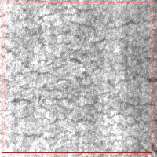</td>
<td align="center"><b>HSV · Conservative</b><br>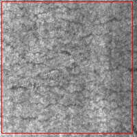</td>
</tr>
<tr>
<td align="center"><b>Flip · Baseline</b><br>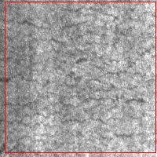</td>
<td align="center"><b>Flip · Conservative</b><br>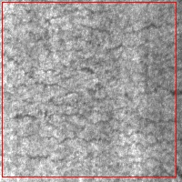</td>
<td align="center"><b>Geometry · Conservative</b><br>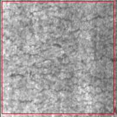</td>
</tr>
</table>

---

## 实验一：分辨率对照

提升输入分辨率是改善小目标检测的直觉方案，代价是推理延迟。固定协议下对照 320 与 416（验证集）：

| 配置 | Precision | Recall | mAP50 | mAP50-95 | 端到端延迟 |
|---|---|---|---|---|---|
| YOLO11n @ 320 | 0.585 | 0.727 | 0.730 | 0.419 | 11.35 ms（同批次对照） |
| YOLO11n @ 416 | 0.698 | 0.693 | 0.747 | **0.423** | 12.96 ms mean / 16.21 ms P95 |

**结论**：416 的 mAP50-95 仅高出 0.004，但弱类 `rolled-in_scale` AP50 反而从 0.444 降至 0.432，同时延迟上升约 14%。分辨率提升对该数据集**不构成有效收益**，后续实验统一保持 320。

原始记录：[`reports/optimization_experiments.md`](reports/optimization_experiments.md)

> **延迟不可跨批次比较**：上表 11.35 / 12.96 ms 来自同一对照批次（另一张测试图），与后文[推理延迟基准](#推理延迟基准)使用不同图像与批次，二者不能直接相减。

---

## 实验二：数据增强单因素消融

保守增强是多个参数**组合调整**的结果。为定位哪一分量真正起作用，设计三组单因素消融：只改 HSV、只改几何（平移+缩放）、只关闭翻转，其余保持 Baseline 默认。

验证集结果（seed 42）：

| 配置 | Precision | Recall | mAP50 | mAP50-95 | 相对 Baseline |
|---|---|---|---|---|---|
| Baseline（默认增强） | 0.5854 | 0.7273 | 0.7295 | 0.4194 | — |
| **Conservative（组合）** | 0.7538 | 0.7114 | **0.7668** | **0.4410** | **+0.0216** |
| HSV-only | 0.6376 | 0.7356 | 0.7286 | 0.4172 | −0.0022 |
| Geometry-only | 0.6652 | 0.7210 | 0.7412 | 0.4283 | +0.0089 |
| Flip-only | 0.6861 | 0.6932 | 0.7363 | 0.4145 | −0.0049 |

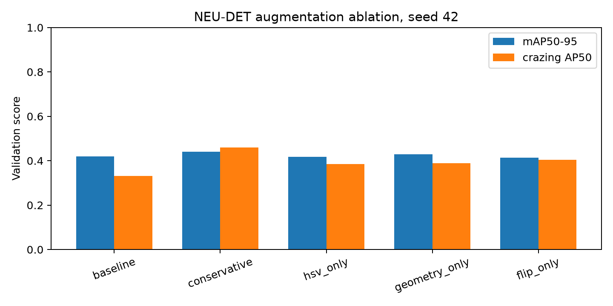

**三点关键发现**：

1. **没有单一因素能复现组合收益。** HSV-only 与 Flip-only 单独使用时 mAP50-95 均**低于** Baseline，Geometry-only 仅贡献 +0.0089。保守增强 +0.0216 的收益来自**多分量联合效应**，而非某一项参数——这是单因素消融最有价值的信息。
2. **Precision 提升伴随 Recall 下降**（0.5854 → 0.7538，0.7273 → 0.7114）。保守增强让模型预测更"克制"、误检更少，代价是漏检略增。在误检成本敏感的质检场景是合理取舍，但需按业务阈值权衡。
3. **弱类改善最明显**：`crazing` AP50 由 0.3322 → 0.4606（**+0.128**），`rolled-in_scale` 由 0.4436 → 0.4895（**+0.046**）；唯一退化的是 `patches`，AP50 由 0.9408 → 0.9200（−0.021）。

证据：[`reports/augmentation_ablation_metrics.json`](reports/augmentation_ablation_metrics.json) ｜ 说明：[`reports/augmentation_ablation.md`](reports/augmentation_ablation.md)

---

## 实验三：多种子稳定性验证

单种子结论可能只是随机波动。对 Baseline 与 Conservative 各跑 **seed 42 / 43 / 44**，在同一固定划分上重复训练（验证集）：

| 配置 | mAP50 (mean ± SD) | mAP50-95 (mean ± SD) | Precision (mean ± SD) | Recall (mean ± SD) |
|---|---|---|---|---|
| Baseline | 0.7279 ± 0.0112 | 0.4230 ± 0.0032 | 0.6165 ± 0.0283 | 0.7345 ± 0.0064 |
| **Conservative** | **0.7560 ± 0.0095** | **0.4354 ± 0.0050** | **0.7028 ± 0.0450** | 0.7283 ± 0.0151 |

**结论**：Conservative 的 mAP50-95 均值高出 Baseline **0.0124**，两组区间在样本标准差意义上不重叠（0.4230±0.0032 vs 0.4354±0.0050），收益**不是单种子偶然**。同时 Conservative 的 Precision 标准差更大（0.0450 vs 0.0283），对初始化更敏感。

> **统计学边界**：n = 3，样本量不足以支撑正式显著性检验；此处仅报告样本标准差，**不声称 p 值**。

证据：[`reports/augmentation_repeat_metrics.json`](reports/augmentation_repeat_metrics.json)

---

## 最终测试集结果

完成全部验证集驱动的模型选择后，冻结 Conservative seed 42 的 `best.pt`，在 **test split（180 张）** 上做一次性评估。

评估协议：Ultralytics `YOLO.val` 默认设置，AP 采用置信度积分，NMS IoU = 0.7。

### 总体指标

| 指标 | 测试集 | 验证集（对照） |
|---|---|---|
| Precision | **0.7736** | 0.7538 |
| Recall | **0.6758** | 0.7114 |
| mAP50 | **0.7601** | 0.7668 |
| mAP50-95 | **0.4402** | 0.4410 |

### 分类别结果

| 类别 | Precision | Recall | AP50 | AP50-95 | 评价 |
|---|---|---|---|---|---|
| `patches` | 0.862 | 0.822 | **0.907** | **0.597** | 最强类 |
| `scratches` | 0.807 | **0.878** | 0.861 | 0.539 | 强类 |
| `inclusion` | 0.788 | 0.738 | 0.838 | 0.489 | 良好 |
| `pitted_surface` | **0.920** | 0.660 | 0.793 | 0.543 | 精确率高、召回偏低 |
| `rolled-in_scale` | 0.695 | 0.681 | 0.695 | 0.295 | **弱类** |
| `crazing` | 0.570 | **0.277** | 0.466 | **0.179** | **最弱类** |

**分析**：

- 测试集 mAP50-95（0.4402）与验证集（0.4410）高度一致，说明模型**未过拟合验证集**，泛化表现稳定。
- Recall 由验证集 0.7114 降至测试集 0.6758（−0.036），Precision 反向上升（+0.020）。这类波动在 180 张样本上属正常范围，也提示小测试集上指标方差不可忽略。
- 类间差异悬殊：`patches` AP50-95（0.597）是 `crazing`（0.179）的 3.3 倍。`crazing`（龟裂）为细密网状纹理、边界模糊，Recall 仅 0.277，是明确的改进方向。

证据：[`reports/final_candidate_test_metrics.json`](reports/final_candidate_test_metrics.json)

---

## 错误分析

在验证集上对 Baseline 做固定阈值（conf = 0.25）、匹配 IoU = 0.5 的一对一错误归因，共定位 **127 个错误案例**。

### 混淆矩阵

（行 = 真实类别，列 = 预测类别）

| 真实 \ 预测 | crazing | inclusion | patches | pitted | rolled-in | scratches | **漏检(→背景)** |
|---|---|---|---|---|---|---|---|
| crazing | 10 | 0 | 0 | 0 | 0 | 0 | **51** |
| inclusion | 0 | 90 | 0 | 0 | 0 | 0 | 22 |
| patches | 0 | 0 | 85 | 0 | 0 | 0 | 8 |
| pitted_surface | 0 | 0 | 0 | 29 | 0 | 0 | 12 |
| rolled-in_scale | 0 | 0 | 0 | 0 | 28 | 0 | **34** |
| scratches | 0 | 0 | 0 | 0 | 0 | 51 | 1 |
| **背景误检** | 7 | 30 | 34 | 9 | 33 | 39 | — |

### 错误类型构成

127 个案例中：纯误检（FP）**48** 个、纯漏检（FN）**40** 个、漏检与误检并存 **39** 个。

| 类别 | 案例数 | 纯 FN | 纯 FP | FN+FP | 主导模式 |
|---|---|---|---|---|---|
| `crazing` | 28 | **21** | 0 | 7 | **漏检主导** |
| `rolled-in_scale` | 28 | 9 | 5 | **14** | 混合，漏检偏多 |
| `inclusion` | 22 | 3 | **13** | 6 | 误检主导 |
| `scratches` | 18 | 1 | **15** | 2 | **误检主导** |
| `patches` | 17 | 1 | **10** | 6 | 误检主导 |
| `pitted_surface` | 14 | 5 | 5 | 4 | 均衡 |

### 三个核心结论

1. **跨类混淆几乎为零。** 混淆矩阵非对角元素（除背景行/列外）全部为 0，六类缺陷的**类间特征区分度良好**，错误不来自"认错类别"。
2. **`crazing` 与 `rolled-in_scale` 的错误是"看不见"。** 前者 28 个案例中 21 个为纯漏检，混淆矩阵显示 51/61 被判为背景——细密纹理与低对比度导致特征响应弱。
3. **`scratches`、`patches`、`inclusion` 的错误是"看错背景"。** 钢材表面正常纹理（轧制纹路、光照不均、杂点）被判为缺陷，是工业场景的典型难点，也是保守增强主要改善的方向。

分析脚本：[`scripts/error_analysis.py`](scripts/error_analysis.py) ｜ 完整案例：[`reports/baseline_error_analysis/`](reports/baseline_error_analysis/)

---

## ONNX 导出与一致性验证

### 导出

```bash
python scripts/export_onnx.py experiments/yolo11n_320_conservative_aug/weights/best.pt --imgsz 320
```

导出静态 320×320 的 ONNX 模型（约 10 MB），`onnx.checker` 校验通过。导出时简化器（onnxsim）不可用，因此**不声称**图结构已简化。

### PyTorch / ONNX 一致性

使用**完全相同的预处理**（OpenCV BGR → Ultralytics LetterBox 320×320 → RGB CHW float32/255）与**完全相同的 NMS**（conf = 0.25，IoU = 0.7，max_det = 300），在 CPU 后端比对：

| 检查项 | 结果 |
|---|---|
| 检测框数量 | 一致（`same_count: true`） |
| 类别预测 | 一致 |
| 检测框坐标（整数像素） | 一致，最大绝对差 **0.0 px** |
| 置信度最大绝对差 | **4.77 × 10⁻⁷** |
| 原始输出张量最大绝对差 | 1.08 × 10⁻³ |
| 原始输出张量平均绝对差 | 1.94 × 10⁻⁵ |

验证样本：验证集 **6 张图像（每类一张）**全部通过。逐样本数据见 [`reports/onnx_comparison/`](reports/onnx_comparison/)，最终模型核验见 [`reports/final_onnx_consistency.json`](reports/final_onnx_consistency.json)。

> **范围声明**：一致性仅在**上述 6 张样本、上述协议与容差**下得到验证，**不等价于**跨任意设备、任意输入或跨执行提供端的逐位一致。

---

## 推理延迟基准

对最终模型，使用**同一张验证图像**（`crazing_109.jpg`）、**batch = 1**、共享预处理与 NMS，预热 10 次后测量 100 次墙钟时间（含预处理 + 前向 + NMS + 坐标反缩放）：

| 后端 | mean (ms) | P95 (ms) | median (ms) | min (ms) | max (ms) | 等效 FPS |
|---|---|---|---|---|---|---|
| PyTorch MPS | 10.28 | 12.74 | 10.17 | 8.32 | 13.97 | ≈ 97 |
| ONNX Runtime **CPU** | 5.87 | 7.30 | 5.59 | 4.74 | 9.07 | ≈ 170 |
| ONNX Runtime **CoreML**（可回退 CPU） | **2.44** | **3.10** | 2.35 | 2.05 | 3.42 | ≈ 410 |

测试环境：Apple M4，macOS 26.6.2 (arm64)，PyTorch 2.14.1，ONNX Runtime 1.31.0。MPS 计时前已做同步。

**解读与边界**：

1. **CoreML 最快（2.44 ms），但有限定条件。** 会话同时列出 `CoreMLExecutionProvider` 与 `CPUExecutionProvider`，说明不支持的算子会**回退 CPU**；provider 列表本身不能证明整图加速。
2. **ORT CPU 反而快于 PyTorch MPS（5.87 vs 10.28 ms）。** batch = 1 的小负载下，MPS 的 kernel launch 与数据传输开销占比高，该结果**不能外推**到大 batch 或 GPU 密集场景。
3. **三者不是同一硬件口径，不可混为单一"模型速度"。** 报告延迟时必须同时给出后端名称。

原始数据：[`reports/final_backend_benchmark.json`](reports/final_backend_benchmark.json)

---

## 典型预测与错误案例

### 训练曲线与评估图

以最终模型（`yolo11n_320_conservative_aug`）为例，每个实验目录均完整保留全部曲线：

<table>
<tr>
<td align="center"><b>训练 / 验证指标曲线</b><br>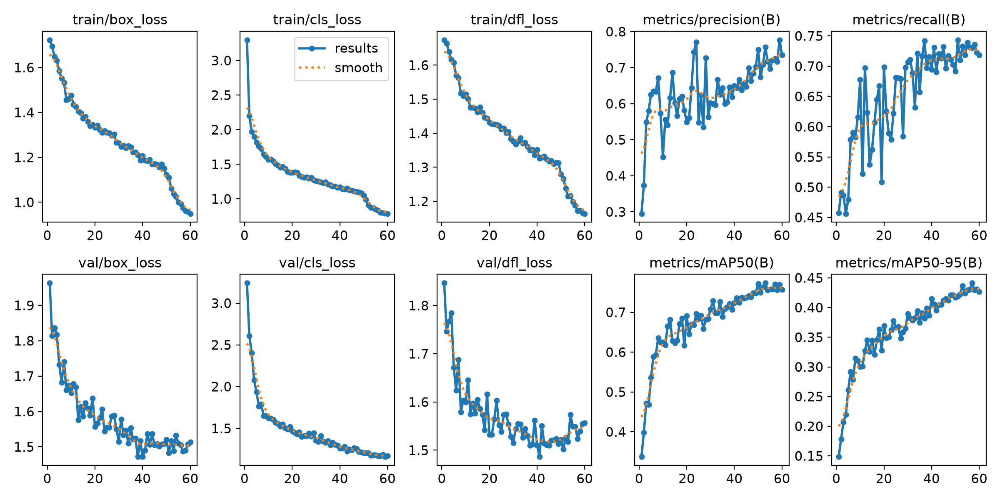</td>
<td align="center"><b>Precision-Recall 曲线</b><br>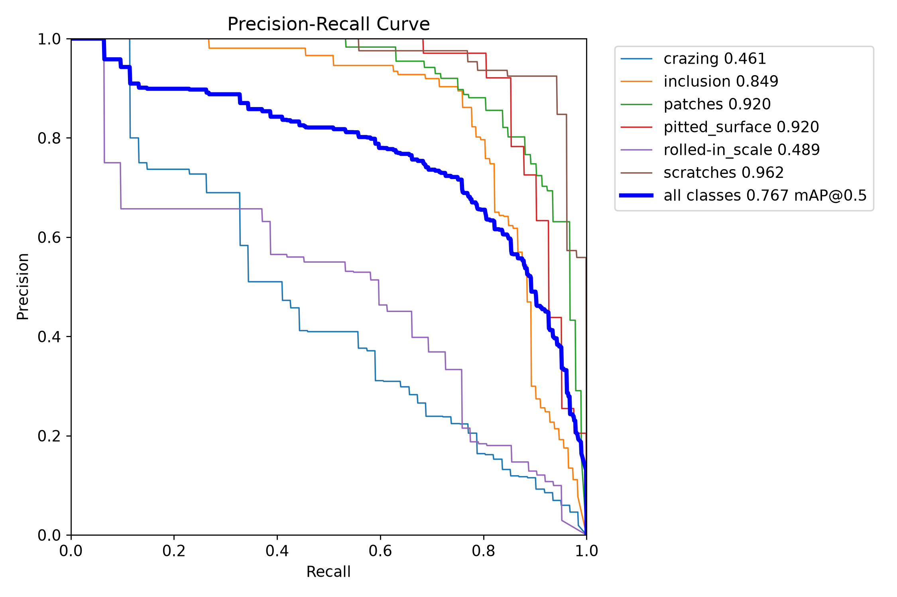</td>
</tr>
<tr>
<td align="center"><b>归一化混淆矩阵</b><br>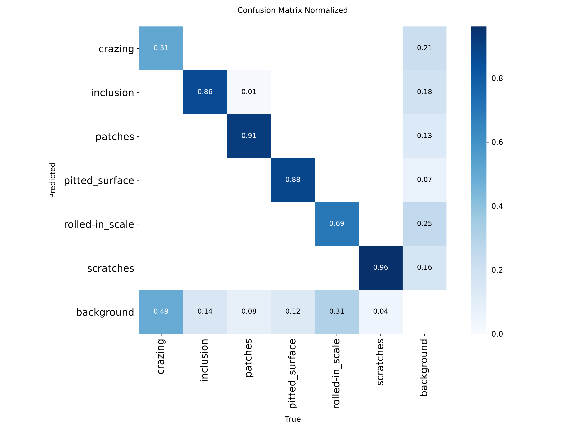</td>
<td align="center"><b>F1 - 置信度曲线</b><br>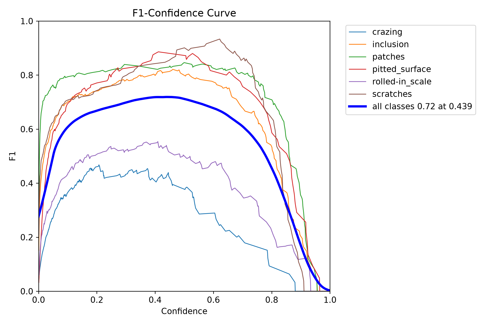</td>
</tr>
</table>

### 错误案例抽样

Baseline 验证集上定位的 127 个错误案例全部保存在 [`reports/baseline_error_analysis/cases/`](reports/baseline_error_analysis/cases/)（<span style="color:green">绿色 = 真实标注</span>，<span style="color:red">红色 = 预测框</span>）。

<details>
<summary><b>展开：典型漏检与误检案例（含量化说明）</b></summary>

**漏检（FN）—— 弱类典型模式**

<table>
<tr>
<td align="center"><code>001_crazing_109</code><br>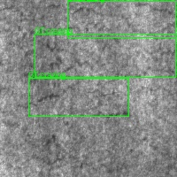<br><sub>GT 3 个 → 预测 <b>0 个</b>：整图完全漏检</sub></td>
<td align="center"><code>012_crazing_220</code><br>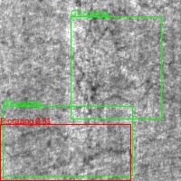<br><sub>GT 2 个 → 预测 1 个：部分漏检</sub></td>
<td align="center"><code>082_rolled-in_scale_109</code><br>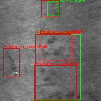<br><sub>GT 2 个 → 预测 5 个：漏检 + 过预测并存</sub></td>
</tr>
</table>

**误检（FP）—— 背景纹理被判为缺陷**

<table>
<tr>
<td align="center"><code>119_scratches_221</code><br>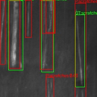<br><sub>GT 3 个 → 预测 <b>8 个</b>：正常轧制纹路被判为划痕</sub></td>
<td align="center"><code>055_patches_180</code><br>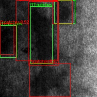<br><sub>GT 3 个 → 预测 5 个：光照不均被判为斑块</sub></td>
<td align="center"><code>034_inclusion_155</code><br>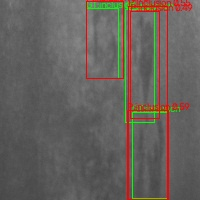<br><sub>GT 3 个 → 预测 4 个：背景杂点误判</sub></td>
</tr>
</table>

</details>

### 置信度阈值扫描（验证集）

仅在验证集扫描。NMS IoU 固定 0.70（预测框之间去重），匹配 IoU 固定 0.50（预测与 GT 是否匹配），**两者不可混淆**：

| 类别 | 阈值 0.25 → 0.45 | Precision | Recall | F1 |
|---|---|---|---|---|
| `scratches` | conf 0.25 | 0.567 | 0.981 | 0.718 |
| `scratches` | conf **0.45** | 0.860 | 0.942 | **0.899** |
| 宏平均（全部类别） | 0.25 / 0.30 | — | — | 0.624 / 0.622 |

**结论**：宏平均 F1 在默认 0.25 处已接近最优，**不支持全局调整默认阈值**；但对 `scratches` 单独采用 0.45 可显著提升 F1（0.718 → 0.899）。这属于**按类别定制部署阈值**，需在冻结策略后独立测试确认，**不能把该扫描结果当作测试集结论**。

曲线：[`reports/confidence_scan/`](reports/confidence_scan/) ｜ 逐类数据：[`metrics.csv`](reports/confidence_scan/metrics.csv)

---

## 项目结构

```
cv-defect-detection/
├── configs/
│   ├── neu_det.yaml              # 数据集定义与六类名称
│   └── experiments.yaml          # 统一实验配置（seed、分辨率、增强参数）
├── scripts/
│   ├── download_dataset.py       # 数据集下载
│   ├── prepare_dataset.py        # VOC XML → YOLO，分层划分 80/10/10
│   ├── validate_dataset.py       # 数据集结构校验
│   ├── audit_dataset.py          # 完整性与跨 split 泄漏审计
│   ├── train.py                  # 统一训练入口（支持 5 种增强配置）
│   ├── evaluate.py               # 验证集 / 测试集评估
│   ├── error_analysis.py         # 错误归因（TP/FP/FN + 可视化）
│   ├── scan_confidence.py        # 置信度阈值扫描
│   ├── run_augmentation_repeats.py   # 多种子重复实验
│   ├── sample_augmentations.py   # 增强效果可视化采样
│   ├── export_onnx.py            # ONNX 导出
│   ├── check_final_onnx.py       # PyTorch / ONNX 一致性核验
│   ├── benchmark_final_backends.py   # 多后端延迟基准
│   ├── predict.py                # 单图 / 目录推理
│   └── check_environment.py      # 环境自检
├── src/common.py                 # 公共工具（路径、种子、指标）
├── tests/test_common.py          # 单元测试
├── data/neu_det/
│   └── split_manifest.json       # 固定划分清单（随仓库发布）
├── experiments/                  # 每次训练：args.yaml、results.csv、曲线图
├── reports/                      # 实验报告、分析 JSON、错误案例、图表
├── requirements.txt              # 最小依赖声明
├── requirements-lock.txt         # 本机验证过的完整版本快照
└── LICENSE
```

> 数据集图像、模型权重（`*.pt`）、ONNX 模型（`*.onnx`）、训练缓存与原始日志均由 `.gitignore` 排除，**不随仓库发布**。

---

## 项目局限性

诚实披露以下边界，评估本工作时须同时考虑：

### 实验设计层面

1. **最终测试并非完全盲测。** 早期 smoke 训练与 Baseline 阶段曾评估过 test split。后续所有模型选择与调参严格只用 val，但 test 已被"见过"，因此 0.4402 应理解为**上界意义下的可信估计**，而非严格无偏的泛化指标。
2. **单种子选优后才测 test。** 最终模型是 Conservative seed 42，其入选部分依据了 seed 42 的验证集表现，存在选择偏差。多种子实验（0.4354 ± 0.0050）给出稳定性参考，但测试集只评估了一次。
3. **测试集仅 180 张。** 小样本下方差不可忽略，分类别指标（尤其 Recall）的置信区间较宽。

### 数据与任务层面

4. **类间性能差距悬殊。** `crazing` AP50-95 仅 0.179、Recall 仅 0.277，`rolled-in_scale` AP50-95 为 0.295，**尚未达到工业可用水平**。
5. **NEU-DET 是实验室基准。** 图像为 200×200 均匀光照的裁剪块，与真实产线的尺度变化、运动模糊、光照不均存在分布差距。
6. **增强消融是组合消融。** 已通过单因素实验定位到收益来自联合效应，但未穷举全部参数组合，也未做增强强度的网格搜索。

### 工程与部署层面

7. **无跨硬件验证。** 全部实验在 Apple Silicon（MPS）完成，**未验证** NVIDIA CUDA / TensorRT 路径，延迟数据不能迁移到 GPU 服务器。
8. **延迟测量存在批次波动。** 早期同协议多次测量出现过 39.75 / 18.85 / 23.00 ms 的显著波动，因此延迟归因需谨慎；本文只报告严格控制条件（同图、batch = 1、预热后 100 次）下的结果。
9. **CoreML 可能回退 CPU。** provider 列表不构成整图加速的证据。
10. **ONNX 一致性范围有限。** 仅在 6 张样本、特定协议与容差下验证，不等于任意输入的逐位一致。

完整披露见 [`reports/final_project_summary.md`](reports/final_project_summary.md) 与 [`reports/execution_status.md`](reports/execution_status.md)。

---

## 开源致谢与许可证

### 第三方依赖与数据

| 组件 | 用途 | 许可证 / 来源 |
|---|---|---|
| [Ultralytics YOLO11](https://github.com/ultralytics/ultralytics) | 检测框架与预训练权重 | **AGPL-3.0**（商业闭源使用需购买 [Ultralytics 商业许可](https://www.ultralytics.com/license)） |
| [NEU-DET](http://faculty.neu.edu.cn/songkechen/zh_CN/zdylm/263270/list/index.htm) | 钢材表面缺陷数据集 | Northeastern University 发布；**本项目不重新分发**，使用者需自行取得合法授权 |
| [COCO8](datasets/coco8/) | 冒烟测试子集（源自 COCO） | 由 Ultralytics 分发，LICENSE 保留在 `datasets/coco8/LICENSE` |

### 本仓库许可证

本仓库**原创内容**（`scripts/`、`src/`、`configs/`、`tests/`、`reports/`）采用 **MIT License**，详见 [`LICENSE`](LICENSE)。

> ⚠️ **AGPL 合规提示**：本仓库代码通过 Python API 调用 Ultralytics，未修改或重新分发其源码。但 Ultralytics 采用 AGPL-3.0，若将本项目作为更大作品的一部分分发，需自行履行 AGPL-3.0 对 Ultralytics 依赖的相应义务，或改用 Ultralytics 商业许可。

### 声明

本项目为个人工程实践作品，基于 Ultralytics 官方 YOLO11 实现完成，**不包含原创检测算法**，也**不是任何学术论文的实验复现**。所有实验结论均以本仓库 `reports/` 下的原始日志与 JSON 为准。

---

## 附：报告索引

| 文档 | 内容 |
|---|---|
| [`reports/execution_status.md`](reports/execution_status.md) | 全部工作项的执行状态与证据 |
| [`reports/final_project_summary.md`](reports/final_project_summary.md) | 项目总结与边界说明 |
| [`reports/baseline_report.md`](reports/baseline_report.md) | Baseline 详细报告 |
| [`reports/optimization_experiments.md`](reports/optimization_experiments.md) | 分辨率对照与阈值策略 |
| [`reports/augmentation_ablation.md`](reports/augmentation_ablation.md) | 增强消融与多种子验证明细 |
| [`reports/error_diagnosis.md`](reports/error_diagnosis.md) | 错误分析与改进假设 |
| [`reports/interview_code_map.md`](reports/interview_code_map.md) | 源码与知识点索引 |
| [`reports/learning_notes.md`](reports/learning_notes.md) | 学习记录 |
